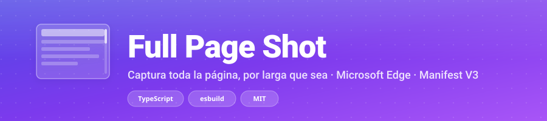

<p align="center">
  
</p>

<p align="center">
  <a href="https://github.com/AlbertoVasquezR/full-page-shot"></a>
  <a href="https://github.com/AlbertoVasquezR/full-page-shot/blob/main/LICENSE"></a>
  
  
  
  
</p>

<p align="center">
  <strong>Capture the whole page, no matter how long, in a single click.</strong><br/>
  <sub>PNG or JPEG · Clipboard · Destination folder · Smart automatic mode</sub>
</p>

<p align="center">
  <a href="#-installation">Installation</a> ·
  <a href="#-usage">Usage</a> ·
  <a href="#-features">Features</a> ·
  <a href="#-frequent-issues">FAQ</a> ·
  <a href="#-license">License</a>
</p>

---

## 🎯 What is Full Page Shot?

A **Microsoft Edge** extension that captures the **entire page** (the whole scroll, regardless of length) and saves it as **PNG** or **JPEG**. Written in **TypeScript** and bundled with **esbuild**.

Unlike normal browser screenshots, which only capture what's visible, Full Page Shot uses the **Chrome DevTools Protocol** to render the page at its real size and return **a single seamless image**. And when content only appears on scroll, it detects the case and walks the page screen by screen.

---

## ✨ Features

### Capture
- 📄 **Real full-page capture** with `Page.captureScreenshot` + `captureBeyondViewport`. One image, no seams.
- 🧠 **Automatic mode** (default): analyzes the page and decides whether to scroll through it. Detects lazy loading, `content-visibility: auto`, entrance animations, scrollable containers, virtualized lists, heavy iframes, scroll-snap, parallax, lazy background images and `IntersectionObserver` changes.
- 📜 **Scroll mode**: walks the view screen by screen and stitches the captures. For content that only appears on scroll.
- ⚡ **Fast mode**: single pass, without scrolling the page.
- 👁️ **Visible mode**: captures only what's on screen right now (ideal for hover states or open menus).
- 📏 **Huge pages**: if they exceed the GPU surface limit, they're captured in segments and stitched on a canvas, with automatic downscaling when needed (tagged `reduced`).
- 🐢 **Lazy loading**: option to walk the page before capturing in fast mode.
- ♾️ **Infinite scroll**: option to keep capturing while the page keeps growing (feeds, lists that load more on scroll).
- 🍪 **Cookie banner dismissal** before capture (OneTrust, Cookiebot, Didomi, Quantcast…).
- 🧹 **Page preparation**: waits for fonts, pauses animations/transitions, forces `content-visibility: visible` and removes `contain` that could hide content. Everything is restored at the end.
- 🎨 **Pre-capture repaint**: improves capture of Canvas/WebGL and animations.
- 📐 **Internal scroll pages**: detects and walks scrollable containers (panels with `html { overflow: hidden }`).

### Output
- 🖼️ **PNG and JPEG** with quality control.
- 📋 **Copy to clipboard** as a real image (not text or HTML).
- 📁 **Destination folder**: subfolder inside Downloads or the native Windows dialog.
- 🔔 **Notification on completion**: clicking it opens the captured image.
- ⌨️ **Keyboard shortcuts**: `Ctrl+Shift+S` (full page) and `Ctrl+Shift+V` (visible only).
- ⏱️ **Configurable delay** (0–10 s) to capture hover states or open menus.
- 🕘 **History** of the last captures in the popup.
- 🌙 **Automatic light/dark theme**.

> **Which one should I pick?** By default **Automatic** decides for you. If you want to force a specific behavior, change it in the popup or in Options.

---

## 🧩 How the clipboard works

Chromium **only** supports copying an image from code through the asynchronous Clipboard API, and that API requires the document to **have focus**. That's why:

1. The copy is performed by the **popup**, which is already focused while you watch progress.
2. If you close the popup before it finishes, the extension opens a **tiny focused helper window** that copies and closes itself.

An *offscreen* document is useless here: it can never gain focus, and the old `document.execCommand("copy")` only leaves text and HTML on the clipboard, not an image. (See chromium/issues/40252021 and 40288517.)

---

## 🚀 Installation

```powershell
npm install
npm run build    # compiles to dist/
```

Then, in Edge:

1. Open `edge://extensions/`.
2. Enable **Developer mode** (bottom left).
3. Click **Load unpacked** and select the **`dist`** folder (not the project root).
4. Pin the extension to the toolbar with the puzzle-piece icon.

> On install, Edge will warn that the extension "can read and change all your data".
> That's the mandatory notice for the `debugger` permission, which is exactly what enables
> true full-page capture. While a capture runs you'll see a yellow "is debugging this browser"
> bar: that's normal and disappears when it finishes.

---

## 🎯 Usage

1. Open the page you want to capture (a normal `http` or `https` page).
2. Click the extension icon.
3. Choose the **format** and the **page walk** (Automatic / Fast / Scroll / Visible).
4. Click **Capture full page** (or press `Ctrl+Shift+S`).
5. The image is saved and, if enabled, copied to the clipboard.

---

## 📜 Scripts

| Command | What it does |
| --- | --- |
| `npm run build` | Compiles `src/` to `dist/` and copies `public/`. |
| `npm run dev` | Same in watch mode (recompiles on save). |
| `npm run typecheck` | Type-checks only, no files generated. |
| `npm run check` | `typecheck` + `build`. |
| `npm run icons` | Regenerates the PNG icons with no dependencies. |
| `node tools/smoke-test.mjs` | Real end-to-end test: launches Edge, captures long pages and checks the downloaded PNG/JPEG, in fast and scroll modes. With `--include-segments` adds a 65,000 px page and a 20,000 px scroll page. With `--only=scroll` filters by name and with `--keep` keeps the downloads. |
| `node tools/verify-clipboard.mjs` | Checks that the clipboard really receives a PNG image (reads the clipboard back), through both paths: popup and helper window. |

After changing code, click **Reload** on `edge://extensions/`.

---

## 📂 Structure

```
full-page-shot/
├── assets/
│   └── banner.svg          README banner
├── public/                 static assets (copied as-is to dist/)
│   ├── manifest.json       Manifest V3
│   ├── popup.html/.css     button UI
│   ├── options.html/.css   options page
│   ├── helper.html         helper window that copies to the clipboard
│   └── icons/              generated icons
├── src/
│   ├── background.ts       service worker: orchestrates capture, copying and download
│   ├── capture.ts          DevTools Protocol logic (measure, capture, stitch)
│   ├── cdp.ts              typed wrapper around chrome.debugger
│   ├── popup.ts            quick UI
│   ├── options.ts          options page
│   ├── helper.ts           helper window (clipboard fallback)
│   ├── clipboard.ts        image writing to the clipboard
│   ├── settings.ts         reading/writing preferences
│   ├── types.ts            shared types and messages
│   └── util.ts             base64, file names, size formatting
├── tools/
│   ├── make-icons.mjs      icon generator (own PNG, no libraries)
│   ├── smoke-test.mjs      end-to-end test
│   └── verify-clipboard.mjs clipboard verification
├── build.mjs               esbuild script + static copy
└── tsconfig.json
```

---

## 🔐 Permissions and why

| Permission | Reason |
| --- | --- |
| `debugger` | The only way to truly capture the full page. |
| `downloads` | Save the file where you choose. |
| `storage` | Store your preferences (`storage.sync`). |
| `clipboardWrite` | Copy the image to the clipboard without a gesture per capture. |
| `notifications` | Notify you when it's done. |
| `activeTab` | Fallback capture for restricted pages. |
| `scripting` | Inject preparation scripts (cookies, fonts, etc.). |

**No site access is requested** (`host_permissions`): the URL and title are read through the DevTools Protocol, not by injecting code.

---

## ⚠️ Real limits (no extension can bypass these)

- **Internal pages and PDFs**: when the debugger is blocked, the extension tries at least a visible-viewport capture with `chrome.tabs.captureVisibleTab` (requires clicking the icon on that page). Not a full capture, but better than nothing. It also retries automatically if a capture fails.
- **PDFs** opened in the internal viewer: blocked by Edge; visible-viewport fallback.
- **Cross-origin iframe content** may come out blank.
- **Canvas/WebGL**: improved with the pre-capture repaint, but some contexts don't render.
- **DevTools open** on the same tab: only one debugger at a time. Close it.
- **Company policies** may block capture (`Screenshot capture is restricted by policy`).
- **Single-shot capture**: `chrome.debugger` rejects captures taller than ~16,000 px, so longer pages are captured **in segments** and stitched.
- **Pages taller than ~30,000 px**: downscaled proportionally to fit the browser canvas (the `reduced` tag indicates it).
- **Copy to clipboard** needs a focused extension page; if you close the popup during capture, a helper window is used.
- **Scroll mode**: slower (one capture per screen). By default it stops at the page's end when capture started; with **Follow infinite scroll** enabled, it keeps capturing while the page keeps growing (feeds, lists that load more on scroll), with a safety cap. It faithfully captures what only appears on scroll.
- **Internal scroll pages**: some apps (panels with `html { overflow: hidden }` and content scrolling inside `body` or a container) are captured by measuring and walking that container.

---

## 🛠️ Frequent issues

| Symptom | Solution |
| --- | --- |
| "A debugger is already attached" | Close DevTools (F12) on that tab. |
| "Edge won't capture this page" | You're on an internal page. Use a normal website, or click the icon on that page to at least capture the visible viewport. |
| Blank capture | Enable *Walk the page before capturing* in Options. |
| Missing or repeated blocks | Switch the **walk** to *Scroll* (content that only appears on scroll). |
| Changed the code and nothing happens | Click **Reload** on `edge://extensions/`. |

---

## 🤝 Contributing

Contributions are welcome! To improve Full Page Shot:

1. **Fork** the repository.
2. **Create a branch** for your change: `git checkout -b feat/my-improvement`.
3. **Install dependencies and build**: `npm install && npm run check`.
4. **Test your changes**:
   - `npm run typecheck` (types).
   - `node tools/smoke-test.mjs` (real end-to-end test).
   - `node tools/verify-clipboard.mjs` (clipboard).
5. **Commit** with a clear message and no AI co-authorship.
6. **Open a Pull Request** describing the change and how to test it.

### Conventions

- **Strict TypeScript**, no plain JavaScript.
- **esbuild** as the only bundler; don't add others.
- Keep the existing code style (Spanish comments and user-facing messages, English identifiers in camelCase).
- Don't add `host_permissions` or content scripts: capture is done via CDP.
- If you add a new option, update `types.ts`, `settings.ts`, `options.html/.ts`, the popup if applicable, and the README.
- Commit messages should be descriptive; avoid automated co-authorship trailers.

### Ideas to contribute

- Support for capturing a selected area.
- Improve automatic detection (new lazy-loading patterns).
- Configurable keyboard shortcuts.
- Internationalization (i18n).
- Tests for new capture paths.

Questions or suggestions? Open an **issue** in the repository.

---

## 🔒 Security

If you find a vulnerability, report it privately from the repository's **Security** tab (see [`SECURITY.md`](./SECURITY.md)). Don't open a public issue.

---

## 📝 License

This project is distributed under the **MIT License**, i.e. free use: you may use, copy, modify, merge, publish, distribute, sublicense and/or sell it, as long as you keep the copyright notice and the license. See the [`LICENSE`](./LICENSE) file for the full text.

Dependencies (esbuild, typescript, @types/chrome, puppeteer-core) are governed by their own licenses.

---

<p align="center">
  <sub>Made with ☕ to capture long pages without complications.</sub>
</p>